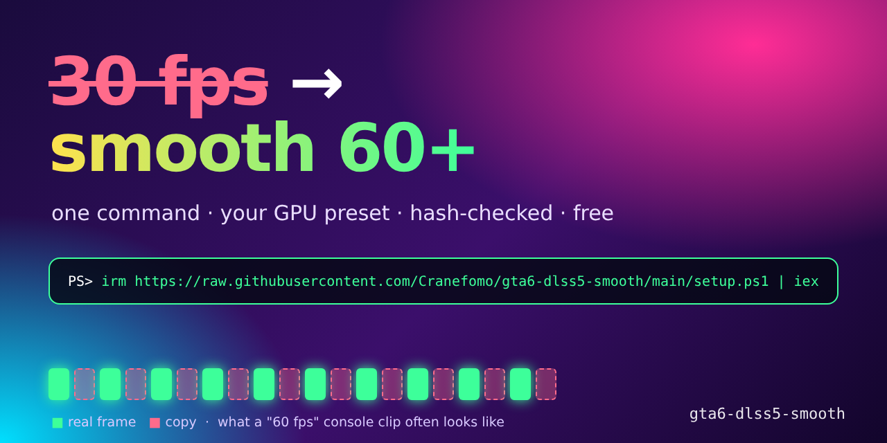
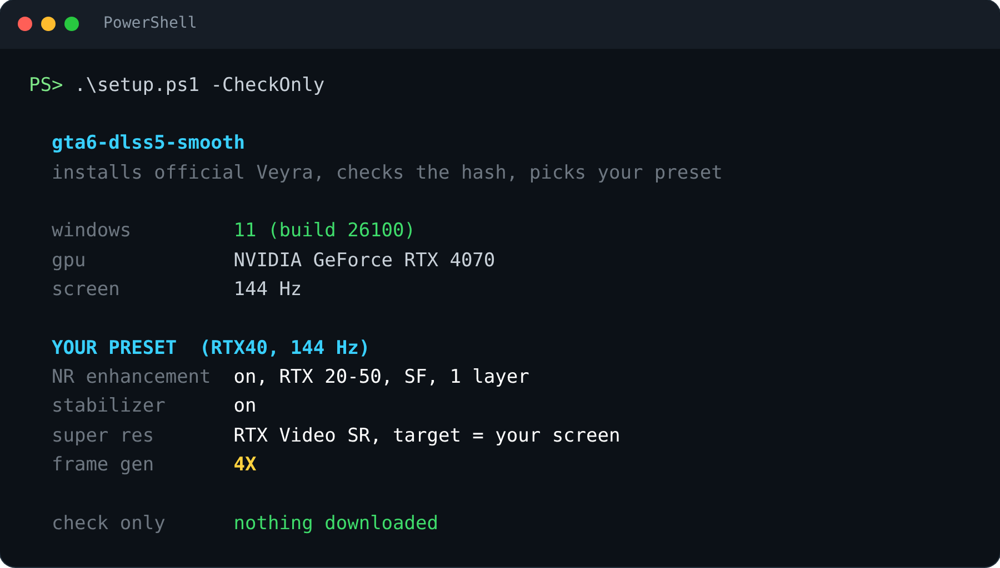
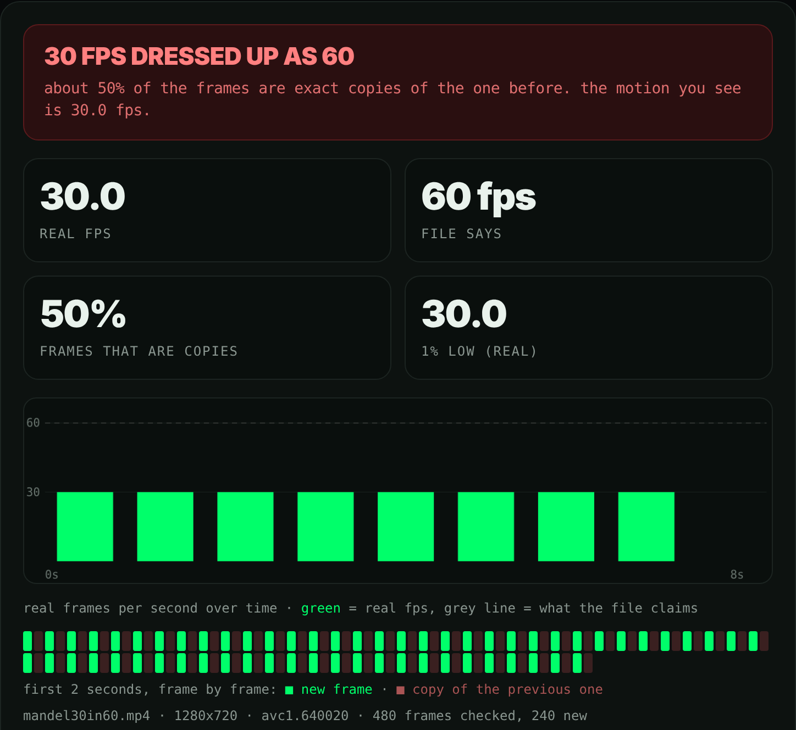

# gta6-dlss5-smooth



**Make GTA 6 clips and streams look smoother on your PC in one command.**

GTA 6 runs at 30 fps on PS5 and PS5 Pro (Digital Foundry). [Veyra](https://github.com/Likely7/Veyra-NRVideo) is a free Windows app that adds frame generation and upscaling to any video you watch. This repo installs the official Veyra build safely and tells you the exact settings for your PC.

```powershell
irm https://raw.githubusercontent.com/Cranefomo/gta6-dlss5-smooth/main/setup.ps1 | iex
```

Read the script first if you like. It's one file, about 150 lines.


<sub>Example output for an RTX 4070 on a 144 Hz screen. Your card and screen get their own preset.</sub>

> Searching for **GTA 6 DLSS 5**? That's what viral posts call Veyra's neural rendering. It's not an official NVIDIA DLSS 5 feature, but it's the same app, installed the safe way.

## What's different here

| | this repo |
|---|---|
| **Shows the plan first** | prints what it will download, from where, to which folder. Nothing happens until you say yes |
| **Your preset, not a table** | reads your GPU and screen refresh rate and prints the settings for that combo. Saves them to `MY-PRESET.txt` next to the app |
| **Double hash check** | the zip must match both the release's `SHA256SUMS.txt` and GitHub's own digest. One mismatch and it deletes the file and stops |
| **Clean uninstall** | `-Uninstall` removes the folder and the shortcut, nothing else |
| **Real FPS checker without Python** | [cranefomo.github.io/realfps](https://cranefomo.github.io/realfps) checks any clip in your browser. No ffmpeg, nothing uploaded |

## Is that clip really 60 fps?


<sub>Real result from [realfps](https://cranefomo.github.io/realfps) on a 30 fps test clip exported at 60. Red = copied frame.</sub>

## Options

```powershell
# only check your GPU + screen and print the preset, download nothing
.\setup.ps1 -CheckOnly

# wrong card detected? set it yourself
.\setup.ps1 -GpuName "RTX 4070" -Hz 144

# skip the question, install somewhere else
.\setup.ps1 -Yes -InstallDir D:\Veyra

# remove everything this script installed
.\setup.ps1 -Uninstall
```

## What the script never does

- ask for admin rights
- touch antivirus, firewall or system settings
- download from anywhere except github.com
- run Veyra for you

## Presets

| GPU | NR enhancement | Frame gen (60 Hz / 120 Hz+) |
|---|---|---|
| RTX 50 | on, NVIDIA original, 2 layers | 2X / 4X |
| RTX 40 | on, SF, 1 layer | 2X / 4X |
| RTX 30 | on, SF, 1 layer | 2X compatibility mode |
| RTX 20 | on, SF, 1 layer | off |
| Radeon RX 7000/9000 | AMD NR (experimental) | AMD 2X |

Needs Windows 11 x64 and one of the cards above.

## Honest notes

- Veyra smooths video **on your PC**: YouTube, Twitch, recordings or a PS5 Remote Play stream. The console itself still renders 30 fps.
- Generated frames are guesses. Fast motion can show artifacts.
- "DLSS 5" in some viral posts is a label, not an official NVIDIA feature of Veyra.

## No guarantee

Free hobby script, provided "as is". You install third-party software at your own risk. Not affiliated with or endorsed by Rockstar Games, Take-Two, Sony, Microsoft, NVIDIA, AMD, Anthropic or the Veyra project.

## Credits

- [Veyra](https://github.com/Likely7/Veyra-NRVideo) by Likely7, GPL-3.0. Not included in this repo, the script downloads it from the official release.
- Idea for a setup wrapper from [phosphenq/gta6-dlss5](https://github.com/phosphenq/gta6-dlss5) (MIT).

Made by [@Cranefomo](https://x.com/Cranefomo). MIT license.
